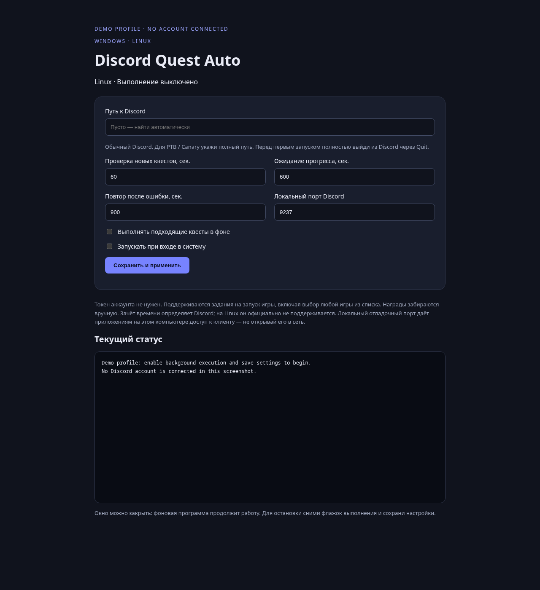
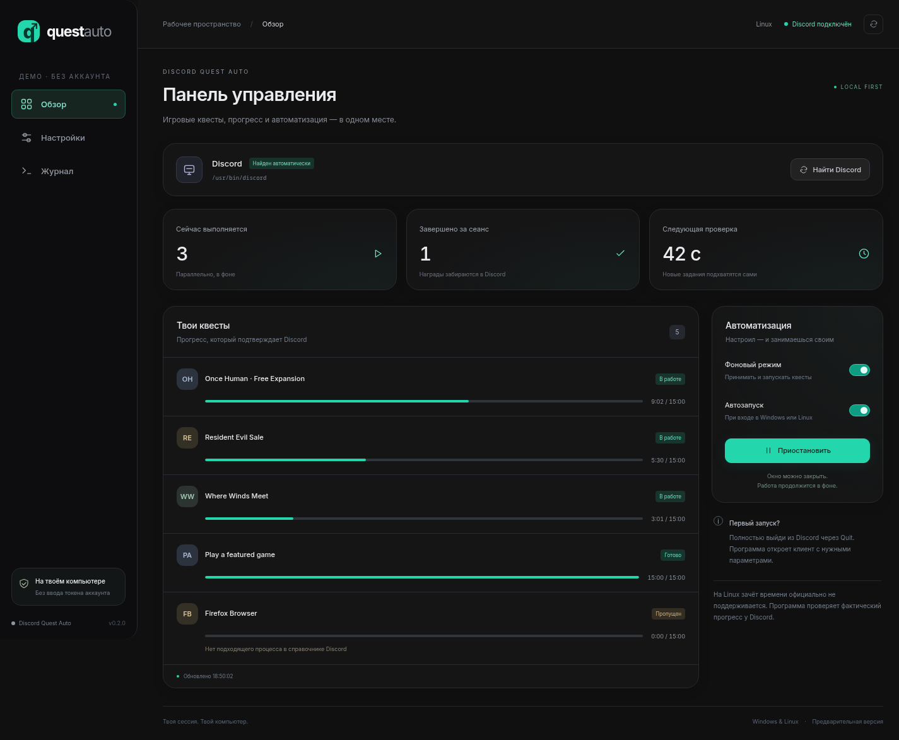
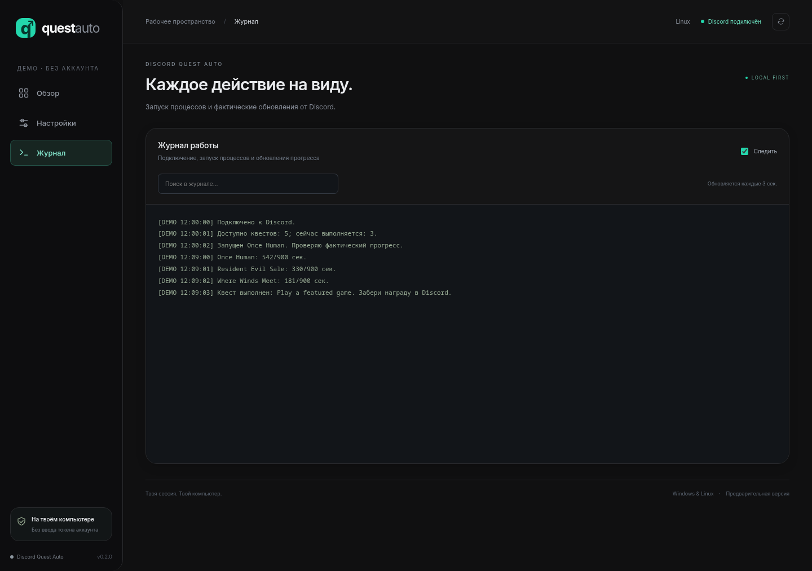

# Discord Quest Auto

**A background Discord play-quest helper for Windows and Linux, with local settings and optional login startup.**

[Русская инструкция](README.ru.md) · [Download ZIP archives](https://github.com/hikkakirishima-sys/discord-quest-auto/releases) · [Build checks](https://github.com/hikkakirishima-sys/discord-quest-auto/actions)

Discover eligible play quests, accept them, and launch lightweight native processes
using executable names from Discord’s application database. Full games are not
installed. Completion is confirmed using progress reported by Discord.

Built with **Node.js, HTML/CSS/JavaScript, Rust (Linux runner, Tauri desktop window), and C (Windows runner)**.
No npm dependencies. Downloads include the runtime and runner.
Inspired by [Discord Quest Completer](https://github.com/markterence/discord-quest-completer).
This project is independent of Discord.

## Screenshots

These show the real interface with a **demo data source**. Progress is illustrative;
no Discord account, control key, or personal data is shown. The current UI is in Russian.

**Settings: automatic client discovery, manual fallback, and timings**



**Status: parallel quests and progress logs**



**Activity log with search and follow mode**



## Install

Download your platform’s ZIP from [Releases](https://github.com/hikkakirishima-sys/discord-quest-auto/releases) and **extract the entire archive**.

| Platform | Install | Run without installing |
| --- | --- | --- |
| Windows x64 | Double-click `Install.vbs`; use the Start menu shortcut | Double-click `Start.vbs` |
| Linux x64 | Run `Install.sh`; use the application menu shortcut | Run `Start.sh` |

No administrator access or separate Node.js/Rust installation is required.
Linux needs glibc 2.28+, `xdg-open`, and the regular Discord desktop client.
Windows automatically checks stable Discord, PTB, Canary, versioned app folders,
and Program Files. Linux checks PATH, standard install folders, Snap, and Flatpak.
Use **Find Discord** to rescan; settings also offer a client selector and manual path.
Flatpak isolation may prevent game detection. Windows Store installs may require a custom path.
Vesktop has not been validated.

1. If Discord is already running without the debugging port, the helper restarts it
   with the right flags (**Restart Discord** toggle, on by default; this drops voice calls).
   With the toggle off, fully quit Discord through its tray/menu **Quit** action first.
2. Open Discord Quest Auto. On Windows this is a native app (`Discord Quest Auto.exe`,
   Tauri + WebView2) with a tray icon: closing the window hides it to the tray, and
   **Exit** in the tray menu stops quests. Login startup opens it straight to the tray.
   On Linux the panel opens as an Edge/Chrome app window or in the default browser.
3. The detected client appears on the overview. Usually no path entry is needed.
4. Click Start, or enable background execution and save. Optionally enable startup when signing in.
5. Close the panel window whenever you like (on Windows it stays in the tray); the agent keeps running.

Execution and startup are **off by default**. Reopen the shortcut to view logs or
change settings. To stop processing, disable execution and save. Claim rewards
manually inside Discord.

## How it works

Discord starts with a loopback-only debugging port. The helper uses the HTTP
client already present in that signed-in desktop session to read and accept
supported quests, then launches a small native runner under a registered
executable name. It monitors actual progress reported by Discord.

| Behavior | Default |
| --- | --- |
| Discover new quests, including while others run | Every 60 seconds |
| Read progress | Every 15 seconds |
| Stop a runner without new progress | After 10 minutes |
| Retry failed attempts | After 15 minutes |
| Refresh the application database | Every hour |
| Concurrent quests | No helper-imposed limit; Discord determines credit |

Quests for the same application share a runner. Any-game quests select one eligible
game from the entire list. Client path, timings, debugging port, execution, and
startup are configurable.

## Compatibility and limits

- Supports `PLAY_ON_DESKTOP`, any-game lists, and PC/console alternatives joined by OR.
- Video, streaming, account linking, and mandatory multi-step AND quests are skipped.
- Entries without suitable executables are skipped, including some Firefox quests.
- Process activity does **not** guarantee quest credit. Parallel quests may receive different credit.
- Rewards must be claimed in Discord. No automatic CAPTCHA or reward claiming.
- Discord [officially does not support earning rewards on Linux](https://support.discord.com/hc/en-us/articles/22225719947543-Discord-Quests-FAQ).
- Internal APIs may change. This is a **preview release**. Native process checks do not establish successful completion of real Windows quests.

## Privacy and local access

The helper does not request, extract, or save a Discord password or account token.
It uses the existing client session. Settings, a separate local control key, and
logs stay in the user profile:

| Platform | Data directory |
| --- | --- |
| Windows | `%LOCALAPPDATA%/DiscordQuestAuto` |
| Linux | `$XDG_DATA_HOME/discord-quest-auto`, usually `~/.local/share/discord-quest-auto` |

The local settings server requires its own random control key. The debugging port
gives other applications on the computer access to Discord; do not expose it to
a network. To disable the port, fully quit Discord and start Discord normally.

Source and release archives exclude settings, keys, logs, and Discord profiles.
Release inputs and Git history were scanned for secrets. Official bundled Node.js
binaries are checked against SHA-256 checksums before packaging.

## Uninstall

Disable execution and startup in settings. Remove the `program` folder from the
data directory and the application/Start menu shortcut. Delete the data directory
to remove remaining logs and settings. When moving a portable folder, disable and
re-enable startup to update its stored paths.

## Development

Node.js 22.15+, no npm dependencies. Build the native runner before testing:

```sh
rustc assets/runner-linux.rs -O -C target-feature=+crt-static -C strip=symbols -o assets/runner-linux
node --test tests/*.test.mjs
node app/agent.mjs --ui
```

The dashboard shows quest cards, real progress, skipped/waiting states, connection
status, and the next discovery scan. Settings and searchable logs have their own tabs.

The release workflow builds both archives and checks native runners on Linux and
Windows. Linux integration tests cover settings persistence, local access control,
startup management, and duplicate-instance prevention. Real Windows quest
completion requires separate validation.

Package with the official runtime on Linux:

```sh
node scripts/download-runtime.mjs
node scripts/package.mjs linux runtime/linux/node
node scripts/package.mjs windows runtime/windows/node.exe
```

MIT. Upstream attribution is preserved in [LICENSE](LICENSE).
Bundled runtime notices: [THIRD_PARTY_NOTICES.md](THIRD_PARTY_NOTICES.md).
