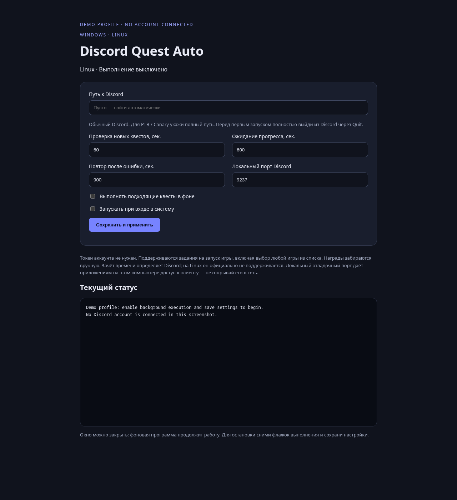
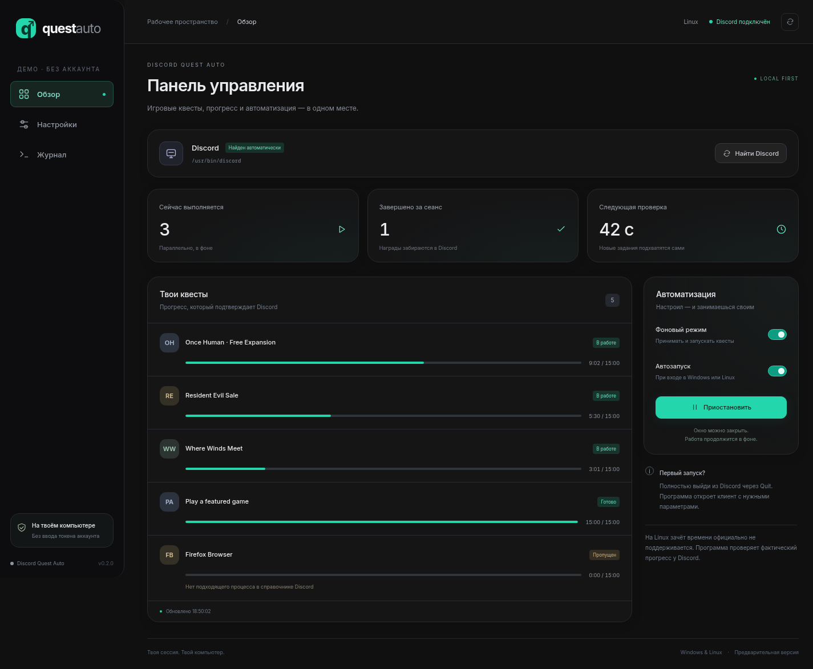
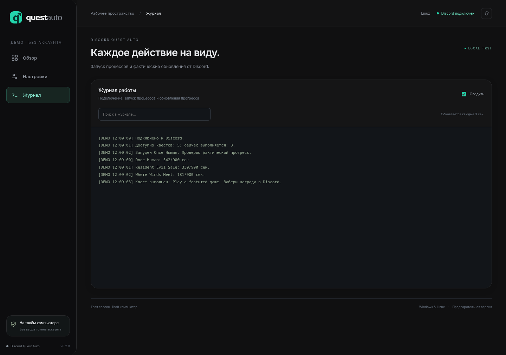

# Discord Quest Auto

[English](README.md) · [Скачать архивы](https://github.com/hikkakirishima-sys/discord-quest-auto/releases)

Фоновый помощник для **Windows x64 и Linux x64**. Находит доступные квесты
Discord на запуск игры, принимает их и запускает небольшие нативные процессы
с именами из справочника Discord. Полные игры не устанавливаются.

Проект основан на идее [Discord Quest Completer](https://github.com/markterence/discord-quest-completer).
Это не продукт Discord. Зачёт времени и доступность наград определяются Discord.

## Установка из архива

Скачай ZIP своей платформы из Releases и **полностью распакуй**.

- **Windows:** открой `Install.vbs`. Появится ярлык Discord Quest Auto в меню Пуск.
  `Start.vbs` позволяет запустить без установки из распакованной папки.
- **Linux:** запусти `Install.sh`. Появится пункт Discord Quest Auto в меню приложений.
  Для запуска без установки — `Start.sh`.

Пакеты содержат Node.js и готовый runner: ставить Node.js, Rust или библиотеки
проекта отдельно не нужно. Linux: нужен glibc 2.28+, xdg-open и обычный Discord.
Windows: обычный Discord с сайта Discord; для Store / PTB / Canary может
потребоваться вручную выбрать путь к exe. Vesktop не тестировался.

Панель управления открывается **отдельным окном** (Edge или Chrome в режиме
приложения, без адресной строки; если их нет — в обычном браузере) с карточками
квестов, прогрессом и состоянием подключения. Настройки и журнал вынесены в отдельные вкладки.
Если Discord уже открыт без отладочного порта, программа сама перезапустит его
с нужными параметрами (переключатель «Перезапускать Discord», включён по умолчанию;
перезапуск выкинет из голосового канала). Без него перед первым включением
полностью выйди из Discord через Quit. Найденный клиент виден на главном экране; обычно вводить путь
не нужно. Кнопка «Найти Discord» повторяет поиск. Windows проверяет обычную
установку, PTB, Canary и каталоги версий. Linux проверяет PATH, стандартные
каталоги, Snap и Flatpak. Изоляция Flatpak может мешать обнаружению процессов.
В настройках есть выбор найденного клиента и ручной путь.
Нажми «Запустить», по желанию включи автозапуск.
Устанавливается для текущего пользователя, права администратора не нужны.

Окно можно закрыть: работа продолжится. Повторное открытие ярлыка показывает
настройки и лог текущего экземпляра. Для остановки выключи выполнение в настройках.
При переносе портативной папки выключи и заново включи автозапуск.

## Что поддерживается

- `PLAY_ON_DESKTOP`, включая выбор любой игры из списка.
- Альтернативы PC / Xbox / PlayStation с условием OR.
- Параллельные квесты; задания одной игры используют общий процесс.
- Новые квесты проверяются каждую минуту, без ожидания завершения текущих.
- Фактический прогресс читается из Discord каждые 15 секунд. При отсутствии
  прогресса 10 минут процесс останавливается; повтор через 15 минут.
- Настройки интервалов, клиента и автозапуска для обеих платформ.

Видео, стримы, сложные задания и квесты с обязательными несколькими действиями
не поддерживаются. Получение наград выполняется вручную в Discord.
Квесты без подходящих executable в справочнике пропускаются (например, некоторые
варианты Firefox). Не все параллельные задания получают время одновременно.

Discord [официально не поддерживает награды на Linux](https://support.discord.com/hc/en-us/articles/22225719947543-Discord-Quests-FAQ).
Успех определяется ответом Discord, а не отображением активности. Внутренние
API клиента могут измениться. Windows-порт собран, но полноценное прохождение
квестов на Windows ещё не подтверждено; версия 0.2.x предварительная.

## Интерфейс

Скриншоты показывают настоящий интерфейс с **демонстрационными данными**.
Прогресс на них приведён для примера. Аккаунт Discord не подключён,
личных данных и токенов на изображениях нет.

## На чём сделано

Node.js и обычные HTML/CSS/JavaScript для локального окна настроек.
Нативный Linux runner написан на Rust, Windows runner — на C.
Зависимостей npm нет. Node.js и готовый runner входят в архив.
GitHub Actions собирает архивы и проверяет нативные процессы на Linux и Windows.

## Данные и доступ к клиенту

Пароль и Discord-токен не запрашиваются, не извлекаются и не сохраняются.
Запросы выполняет существующий HTTP-клиент в открытой сессии Discord.
Локальный отладочный порт даёт другим приложениям на компьютере доступ к клиенту;
не публикуй его в сеть. Для его отключения полностью выйди из Discord и запусти
Discord обычным способом.

Настройки, локальный ключ управления и логи сохраняются только у пользователя:

- Windows: `%LOCALAPPDATA%\DiscordQuestAuto`.
- Linux: `$XDG_DATA_HOME/discord-quest-auto`, обычно `~/.local/share/discord-quest-auto`.

Ключ управления защищает локальное окно настроек и не является токеном Discord.
Исходники и архивы содержат только программу. Локальные настройки, логи, квесты,
профили Discord и ключи управления в релиз не включаются.

## Удаление

Выключи выполнение и автозапуск в настройках, затем удали установленную папку
`program` из каталога данных выше и ярлык в меню приложений / меню Пуск.
Оставшиеся настройки и логи можно удалить вместе с каталогом данных.

## Разработка

Node.js 22.15+, без npm-зависимостей. Проверки: `node --test tests/*.test.mjs`.
Собери runner для своей платформы, затем `node app/agent.mjs --ui`.
По умолчанию выполнение и автозапуск выключены.

Linux runner: `rustc assets/runner-linux.rs -O -C target-feature=+crt-static -o assets/runner-linux`.
Windows runner: `clang --target=x86_64-pc-windows-msvc -c -Oz -fno-stack-protector -o runner.obj assets/runner-win.c`,
затем `llvm-dlltool -m i386:x86-64 -d assets/kernel32.def -l kernel32.lib` и
`lld-link /entry:mainCRTStartup /subsystem:windows /nodefaultlib /out:assets/runner-win.exe runner.obj kernel32.lib`.

Упаковка: `node scripts/package.mjs linux|windows /path/to/node`.
До упаковки положи лицензию этой версии Node в `runtime/NODE-LICENSE`.
Официальный runtime проверяется по SHA-256 перед включением в архив.

MIT. Сохранены исходная лицензия и сведения об авторе upstream.
